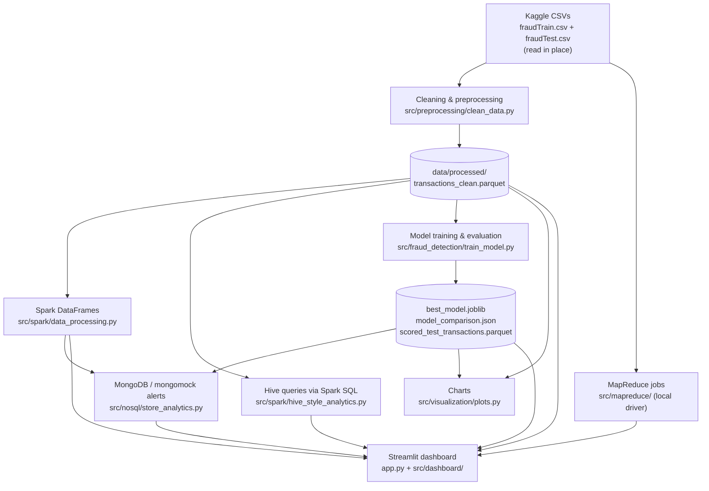

# Credit Card Fraud Detection Using Transaction Analytics

**Semester V Big Data Architecture Mini-Project** · B.Tech AI & Data Science

An end-to-end credit card fraud detection and transaction analytics pipeline built on the Kaggle *Credit Card Transactions Fraud Detection* dataset (1.85 million simulated transactions). It cleans the data and aggregates it with MapReduce. It runs Hive-style SQL analytics through Spark SQL and processes the data with Spark DataFrames. It trains and compares fraud classifiers and stores fraud alerts in MongoDB. The results are presented in static charts and an interactive Streamlit dashboard.

Every stage runs locally on a Windows laptop. Hadoop/HDFS, Hive and a MongoDB server are **not** required for the local run. The project includes the real HiveQL scripts, Hadoop Streaming commands and HDFS ingestion commands for running against a cluster, but these have not been executed against real cluster infrastructure. See [Big Data components](#13-big-data-components).

---

## Contents

1. [Overview](#1-overview)
2. [Key features](#2-key-features)
3. [Architecture and workflow](#3-architecture-and-workflow)
4. [Technology stack](#4-technology-stack)
5. [Machine-learning methodology](#5-machine-learning-methodology)
6. [Dataset and setup](#6-dataset-and-setup)
7. [Installation](#7-installation)
8. [Running the pipeline](#8-running-the-pipeline)
9. [Launching the dashboard](#9-launching-the-dashboard)
10. [Evaluation metrics and results](#10-evaluation-metrics-and-results)
11. [Analytics results](#11-analytics-results)
12. [Project structure](#12-project-structure)
13. [Big Data components](#13-big-data-components)
14. [Testing](#14-testing)
15. [Limitations](#15-limitations)
16. [Future improvements](#16-future-improvements)
17. [References and dataset attribution](#17-references-and-dataset-attribution)

---

## 1. Overview

Credit card fraud is rare (about 0.5% of the transactions in this dataset) but each case is costly. Transaction volumes are also too large for manual review. The project addresses two linked problems:

1. **Big Data analytics**: storing, aggregating and querying a large transaction dataset with the Hadoop-ecosystem programming models (HDFS layout, MapReduce, Hive, Spark, NoSQL).
2. **Imbalanced classification**: building a fraud classifier that is evaluated with precision, recall, F1, ROC-AUC and PR-AUC. Raw accuracy is meaningless when more than 99% of transactions are legitimate.

The dataset is **simulated** (Sparkov generator), not real bank data. Results describe this dataset only and do not establish how the model would perform on production banking transactions.

## 2. Key features

- **Real-dataset ingestion**: reads the Kaggle `fraudTrain.csv` and `fraudTest.csv` in place, at configurable paths. Missing files raise an error; there is no substitute dataset.
- **Preprocessing**: drops the unnamed index column, deduplicates, handles missing values, parses dates, and derives time, age, distance and high-value features. Output is a single Parquet file.
- **MapReduce**: two Hadoop-Streaming-compatible mapper/reducer jobs (per category, per anonymized card), run locally by a driver that simulates the shuffle/sort step.
- **Hive / Spark SQL**: eleven HiveQL analytics queries. The same queries are executed locally through Spark SQL.
- **Spark DataFrames**: filtering, `groupBy().agg()` and Spark SQL over temp views.
- **Fraud detection**: Logistic Regression, Random Forest and XGBoost are compared. Validation uses a chronological holdout, and the threshold is chosen on validation data. Final metrics come from the separate test file.
- **Inference**: validated scoring of single transactions or CSV batches, using the exact training-time feature code.
- **NoSQL**: fraud alerts stored as nested MongoDB documents, plus a MongoDB aggregation pipeline. Without a server, it falls back automatically to the in-memory `mongomock`.
- **Visualization**: 9 matplotlib charts written to `results/figures/`.
- **Streamlit dashboard**: six pages covering dataset overview, transaction analytics, a single-transaction fraud check, model performance, MongoDB fraud alerts, and batch CSV scoring.

## 3. Architecture and workflow



`scripts/run_pipeline.ps1` runs the stages in this order:

| Step | Stage | Command run by the script |
|---|---|---|
| 1 | Check that both Kaggle CSVs exist and are readable | inline `check_raw_file()` call |
| 2 | Cleaning & preprocessing | `src\preprocessing\clean_data.py` |
| 3 | MapReduce: category and customer aggregation | `src\mapreduce\local_driver.py category_aggregation` / `customer_aggregation` |
| 4 | Spark DataFrame processing and Spark SQL (Hive-style) analytics | `src\spark\data_processing.py`, `src\spark\hive_style_analytics.py` |
| 5 | Model training/evaluation, then saved-model verification | `src\fraud_detection\train_model.py`, `src\fraud_detection\verify_model.py` |
| 6 | Load alerts and category analytics into MongoDB/mongomock | `src\nosql\store_analytics.py` |
| 7 | Generate charts | `src\visualization\plots.py` |

The script stops at the first step that returns a non-zero exit code.

## 4. Technology stack

| Layer | Technology | How it is used here |
|---|---|---|
| Language | Python 3.11 | Project venv (`venv\`) |
| Data handling | pandas, NumPy, PyArrow | Fast CSV loading, Parquet I/O |
| Storage (HDFS) | Local `data/` folders as HDFS stand-ins | Real HDFS commands in `scripts/hdfs_ingest.sh` and `docs/HDFS_SETUP.md` (not executed) |
| Batch aggregation | MapReduce (Hadoop Streaming pattern) | Runs locally via `local_driver.py`; cluster submission documented |
| SQL-on-Hadoop | Hive (HiveQL) | `.hql` scripts provided; the same queries executed through Spark SQL |
| Distributed processing | Apache Spark (PySpark 4.x), Spark SQL | `local[*]` mode; requires JDK 17 or 21 |
| NoSQL | MongoDB via `pymongo`, `mongomock` fallback | Real server if configured, otherwise in-memory |
| Machine learning | scikit-learn, XGBoost | Model training, evaluation, inference |
| Visualization | matplotlib (charts), Plotly (dashboard) | `results/figures/`, Streamlit pages |
| Dashboard | Streamlit | `app.py` |
| Testing | pytest, Streamlit `AppTest` | `tests/` |

`requirements.txt` also lists `seaborn`, `imbalanced-learn`, `pyyaml` and `tqdm`, but nothing in `src/`, `app.py` or `tests/` imports them.

## 5. Machine-learning methodology

### Features (75 model inputs)

Built by `src/fraud_detection/features.py`:

| Group | Columns |
|---|---|
| Numeric | `amt`, `txn_hour`, `customer_age` (age at transaction time), `customer_merchant_distance_km` (haversine), `city_pop` |
| Boolean | `is_weekend`, `is_night_txn` (00:00-04:59), `is_high_value` (`amt` >= $500) |
| One-hot | `category` (14), `state` (51 incl. DC), `gender` (2) |

Columns deliberately excluded from the model:

- **The label `is_fraud`**: an assertion in `build_features()` rejects the label or identifier columns if they ever reach the feature matrix.
- **Identifiers**: `trans_num`, `unix_time`, `cc_num`, `first`, `last`, `street`, `zip`. There are only about 1,000 cards, so these would let the model memorise customers.
- **High-cardinality fields**: `merchant` (693), `city`, `job`.
- **Raw coordinates**: used only through the distance feature.
- **`txn_month`**: the train and test files cover different periods, so month mostly encodes the year.

Identifiers stay in the data for alerts and reports, masked where displayed.

### Models and class imbalance

`src/fraud_detection/train_model.py` trains three classifiers:

| Model | Configuration | Imbalance handling |
|---|---|---|
| Logistic Regression | `StandardScaler` + `LogisticRegression(max_iter=1000)` in a pipeline | `class_weight="balanced"` |
| Random Forest | 100 trees, `max_depth=14`, `min_samples_leaf=5` | `class_weight="balanced_subsample"` |
| XGBoost | 400 trees, `max_depth=6`, `learning_rate=0.1`, `hist` | `scale_pos_weight` = legitimate/fraud ratio of the training rows |

No oversampling or undersampling is used. `random_state=42` throughout.

### Validation and test strategy

- **Training and validation**: only `fraudTrain.csv` is used. It is sorted by timestamp and split chronologically.
  - **Fit set**: the earliest 80%, 1,037,340 rows (2019-01-01 to 2020-03-06).
  - **Validation set**: the latest 20%, 259,335 rows (2020-03-06 to 2020-06-21).
  - The one-hot column layout and the logistic-regression scaler are learned from the fit rows only.
- **Model selection**: the model with the highest **validation PR-AUC** is kept.
- **Decision threshold**: the F1-optimal point of that model's **validation** precision-recall curve.
- **Final test**: `fraudTest.csv` (all 555,719 rows) is scored **once** by the selected model at that fixed threshold. It is not merged with training data, re-split, fitted on or used for tuning.
- **No refit**: the selected model is not retrained on the validation rows, so the stored threshold matches the stored model exactly.

Reported metrics: ROC-AUC, PR-AUC (average precision), and precision, recall, F1 and the confusion matrix, each at both 0.5 and the chosen threshold.

### Saved artifacts

| Artifact | Contents |
|---|---|
| `results/models/best_model.joblib` | Dict with `model`, `feature_names` (training column order), `model_name`, `decision_threshold`, `schema_version` (`kaggle-sparkov-v1`), feature lists, training-file path, timestamp, scikit-learn version |
| `results/metrics/model_comparison.json` | Split details, per-model **validation** metrics (`models`), `best_model`, `decision_threshold`, and the selected model's **final test** metrics (`test`) |
| `results/fraud_detection/scored_test_transactions.parquet` | Fraud probability and prediction for every `fraudTest.csv` transaction. Used by the alerts, charts and dashboard; these are out-of-sample scores, not training-data scores |

`inference.load_model_bundle()` refuses a bundle with a different `schema_version`, for example a model trained before the Kaggle migration, and asks you to retrain.

### How predictions are made

`src/fraud_detection/inference.py` scores new transactions in four steps:

1. **Validate** the 11 raw input fields: `trans_date_trans_time`, `amt`, `category`, `state`, `gender`, `dob`, `city_pop`, `lat`, `long`, `merch_lat`, `merch_long`. The checks are:
   - parseable dates, with date of birth before the transaction;
   - `amt > 0`;
   - valid coordinates;
   - category, state and gender values that were seen in training.

   Invalid rows are reported with reasons and skipped.
2. **Derive features** with the same `add_derived_features()` used during cleaning.
3. **Encode** with `build_features()` and align to the saved `feature_names`.
4. **Score**: output `fraud_probability`, `predicted_fraud` (probability >= the stored threshold), and a risk level:
   - **High**: at or above the threshold;
   - **Elevated**: from 0.5 up to the threshold;
   - **Low**: below 0.5.

## 6. Dataset and setup

### Source

**Credit Card Transactions Fraud Detection Dataset** by `kartik2112` on Kaggle:
<https://www.kaggle.com/datasets/kartik2112/fraud-detection>

It was generated with the Sparkov Data Generation tool and simulates transactions of about 1,000 US cardholders at 693 merchants. It is **simulated data, not real bank transactions**. It was chosen over the anonymized-PCA ULB dataset because its named merchant, category, location and customer columns make category-, state-, merchant- and customer-level analytics possible.

| File | Rows | Fraud | Fraud rate | Period | Role in this project |
|---|---|---|---|---|---|
| `fraudTrain.csv` | 1,296,675 | 7,506 | 0.579% | 2019-01-01 to 2020-06-21 | Training + validation |
| `fraudTest.csv` | 555,719 | 2,145 | 0.386% | 2020-06-21 to 2020-12-31 | Final test only |

Both files have 23 columns: an unnamed leading row index (dropped on load), `trans_date_trans_time`, `cc_num`, `merchant`, `category`, `amt`, `first`, `last`, `gender`, `street`, `city`, `state`, `zip`, `lat`, `long`, `city_pop`, `job`, `dob`, `trans_num`, `unix_time`, `merch_lat`, `merch_long`, `is_fraud`. Full column notes are in [`docs/DATASET.md`](docs/DATASET.md).

**The CSV files are not part of this repository and should not be committed.** `.gitignore` excludes CSV and Parquet data files.

### Where the project looks for the files

`config/config.py` reads the two files **separately and in place**. They are not combined, and not copied into `data/raw/`:

| Setting | Environment variable | Default when the variable is unset |
|---|---|---|
| `TRAIN_CSV` | `BDA_TRAIN_CSV` | `%USERPROFILE%\Downloads\archive (5)\fraudTrain.csv` |
| `TEST_CSV` | `BDA_TEST_CSV` | `%USERPROFILE%\Downloads\archive (5)\fraudTest.csv` |

Use either option:

- **Default location**: extract the Kaggle archive so the files are at `%USERPROFILE%\Downloads\archive (5)\fraudTrain.csv` and `...\fraudTest.csv`.
- **Any other location**: set the variables in the PowerShell session before running anything:

  ```powershell
  $env:BDA_TRAIN_CSV = "E:\datasets\fraud\fraudTrain.csv"
  $env:BDA_TEST_CSV  = "E:\datasets\fraud\fraudTest.csv"
  ```

If a file is missing or unreadable, preprocessing and the MapReduce driver stop with an error naming the path and these variables.

### Downloading

1. Sign in to Kaggle, open the dataset page above, and download the archive.
2. Extract `fraudTrain.csv` and `fraudTest.csv` (about 351 MB and 150 MB).
3. Place them at the default location or set the two variables as shown above.

## 7. Installation

All commands below are for **Windows PowerShell**, run from the project root.

**Prerequisites**

- Python 3.11 (the version the project was developed and tested with; the `py` launcher is used below). Very new Python releases may not yet be supported by PySpark/XGBoost.
- Git.
- **For the Spark steps only**: a JDK 17 or 21. PySpark 4.x does not start on newer JDKs; see [`docs/SPARK_SETUP.md`](docs/SPARK_SETUP.md).
- About 2 GB of disk for the venv, plus about 150 MB for the cleaned Parquet file.

```powershell
# 1. Clone and enter the project
git clone https://github.com/praveen-ramanan/Credit-Card-Fraud-Detection-Using-Transaction-Analytics.git
cd Credit-Card-Fraud-Detection-Using-Transaction-Analytics

# 2. Create the virtual environment (the pipeline script expects it at .\venv)
py -3.11 -m venv venv

# 3. Install dependencies
.\venv\Scripts\python.exe -m pip install --upgrade pip
.\venv\Scripts\python.exe -m pip install -r requirements.txt
```

Activating the venv is optional, because every command in this README calls `.\venv\Scripts\python.exe` directly. To activate it anyway:

```powershell
.\venv\Scripts\Activate.ps1
```

If PowerShell blocks this script, first run `Set-ExecutionPolicy -Scope Process -ExecutionPolicy Bypass`, which applies to the current window only.

Then download the dataset as described in [Dataset and setup](#6-dataset-and-setup).

## 8. Running the pipeline

### Complete pipeline

```powershell
powershell -ExecutionPolicy Bypass -File .\scripts\run_pipeline.ps1
```

(`.\scripts\run_pipeline.ps1` works directly if your execution policy already allows local scripts.)

This runs the seven steps in [Architecture and workflow](#3-architecture-and-workflow). Things to know:

- **JDK path**: the Spark steps point `JAVA_HOME` at `C:\Program Files\Java\jdk-21.0.10`, which is hard-coded as `$SparkJavaHome` in the script. Edit that line if your JDK 17/21 is elsewhere. If the path does not exist, the script prints a warning, and the Spark steps fail unless your default Java is compatible.
- **Paths with parentheses**: Spark's Windows launch scripts fail when the project path contains `(` or `)` (for example `Credit Card(BDA)`). The script detects this and runs the Spark steps through a directory junction at `%TEMP%\bda_venv` that links to the venv. Nothing is copied.
- **MongoDB**: the NoSQL step uses a MongoDB server if one is configured or reachable; otherwise it uses `mongomock` ([details](#nosql-mongodb)).
- **Runtime**: cleaning takes about 10 s, MapReduce about 30 s, and training all three models about 1 minute on an 18-thread laptop.

### Individual stages

```powershell
.\venv\Scripts\python.exe src\preprocessing\clean_data.py        # -> data\processed\transactions_clean.parquet
.\venv\Scripts\python.exe src\mapreduce\local_driver.py category_aggregation
.\venv\Scripts\python.exe src\mapreduce\local_driver.py customer_aggregation
.\venv\Scripts\python.exe src\fraud_detection\train_model.py     # needs the cleaned Parquet
.\venv\Scripts\python.exe src\fraud_detection\verify_model.py    # re-checks the saved model, no retraining
.\venv\Scripts\python.exe src\nosql\store_analytics.py           # needs the test scores (and Spark output for category docs)
.\venv\Scripts\python.exe src\visualization\plots.py
```

Spark stages: set a compatible JDK first, in the same PowerShell window.

```powershell
$env:JAVA_HOME = "C:\Program Files\Java\jdk-21.0.10"   # your JDK 17/21 path
$env:PATH = "$env:JAVA_HOME\bin;" + $env:PATH
.\venv\Scripts\python.exe src\spark\data_processing.py
.\venv\Scripts\python.exe src\spark\hive_style_analytics.py
```

If your project path contains parentheses, run the two Spark stages through `run_pipeline.ps1` instead, or clone into a path without parentheses.

To score one example transaction from the command line:

```powershell
.\venv\Scripts\python.exe src\fraud_detection\inference.py
```

`notebooks/train_model_colab.ipynb` runs the cleaning and training stages on Google Colab. It clones the GitHub repository, so it uses whatever version of the code has been pushed there. It downloads the dataset with `kagglehub`, which needs Kaggle credentials on the Colab runtime. The last cell prints the model and metrics as base64 so they can be copied back into `results/`.

## 9. Launching the dashboard

The dashboard reads the pipeline outputs and never retrains. Run the pipeline first: at minimum preprocessing and training, and also the MapReduce, Spark and NoSQL stages for every page to be complete.

```powershell
.\venv\Scripts\python.exe -m streamlit run app.py
```

Then open **<http://localhost:8501>**. The app runs locally and is not deployed publicly. Using `python -m streamlit` guarantees the venv's packages are used. A bare `streamlit run app.py` works only when the venv is activated.

| Page | What it shows | Data source |
|---|---|---|
| **Overview** | Train/test summary table (rows, fraud, rate, period, cards, merchants, value); dataset selector (fraudTrain / fraudTest / both); totals, fraud rate, amount statistics; fraud vs legitimate counts; amount distribution by class; daily volume; daily fraud count with 7-day fraud rate | Cleaned Parquet |
| **Transaction analytics** | Dataset selector plus sidebar filters (date, category, state, gender, amount); fraud rate by category, by hour and by amount band; high-value segment; merchant and card summaries (cards masked to the last 4 digits); browser for the Hive/Spark SQL, Spark and MapReduce output files | Cleaned Parquet, `results/hive_analytics`, `spark_output`, `mapreduce_output` |
| **Fraud detection** | Form for one transaction (amount, date/time, category, state, gender, date of birth, city population, customer and merchant coordinates); buttons to load a real legitimate or fraud example from `fraudTest.csv`; fraud probability, risk level, derived model inputs | Saved model via `inference.py` |
| **Model performance** | Final `fraudTest.csv` metrics (ROC-AUC, PR-AUC, precision, recall, F1, false positives/negatives), confusion matrix, ROC and precision-recall curves; threshold explorer (labelled as illustration only); validation comparison table, chart and per-model confusion matrices | `model_comparison.json`, `scored_test_transactions.parquet` |
| **Fraud alerts** | The 500 highest-scored `fraudTest.csv` transactions in the `fraud_alerts` collection; filters by category, state, actual label and minimum probability; sorting; the generated MongoDB `find()` query; model prediction vs actual label; alert precision; CSV download | MongoDB, or mongomock loaded from the test scores |
| **CSV analysis** | Upload Kaggle-schema rows; validation report; risk-level and probability distributions; ROC-AUC, PR-AUC, precision and recall if an `is_fraud` column is present; scored CSV download; template CSV download | Saved model via `inference.py` |

Model outputs are risk scores, not verified fraud outcomes. The pages label model predictions separately from the dataset's actual `is_fraud` labels.

If an output file is missing, the page names the file and the command that creates it. If the saved model predates the current feature schema, the app shows a "retrain" error instead of using it.

Streamlit's default upload limit is 200 MB, so `fraudTest.csv` (150 MB) can be uploaded on the CSV analysis page but the full `fraudTrain.csv` (351 MB) cannot. Rows from `fraudTrain.csv` were also seen in training, so their scores would be optimistic.

## 10. Evaluation metrics and results

All values below are copied from `results/metrics/model_comparison.json`, produced by `train_model.py`.

### Validation (model selection)

Latest 20% of `fraudTrain.csv`: 259,335 transactions, 1,538 fraud. "@thr" is each model's own validation F1-optimal threshold.

| Model | ROC-AUC | PR-AUC | Precision @0.5 | Recall @0.5 | Threshold | Precision @thr | Recall @thr | F1 @thr |
|---|---|---|---|---|---|---|---|---|
| Logistic Regression | 0.9452 | 0.1984 | 0.040 | 0.825 | 0.924 | 0.304 | 0.560 | 0.394 |
| Random Forest | 0.9939 | 0.8348 | 0.399 | 0.923 | 0.766 | 0.791 | 0.743 | 0.766 |
| **XGBoost (selected)** | **0.9980** | **0.8986** | 0.471 | 0.930 | **0.949** | 0.878 | 0.803 | **0.839** |

### Final test (`fraudTest.csv`)

The selected XGBoost model was scored on all 555,719 transactions (2,145 fraud) at the validation-chosen threshold of 0.9493.

| Metric | Value |
|---|---|
| ROC-AUC | 0.9970 |
| PR-AUC (average precision) | 0.8554 |
| Precision | 0.8127 |
| Recall | 0.7767 |
| F1 | 0.7943 |
| Confusion matrix | TP 1,666 · FP 384 · FN 479 · TN 553,190 |
| For comparison, at threshold 0.5 | Precision 0.3689 · recall 0.9152 · FP 3,358 · FN 182 |

How to read these numbers:

- Of the transactions the model flags in the later, unseen test period, 81% are fraud, and it finds 78% of all fraud.
- Test PR-AUC (0.855) is lower than validation PR-AUC (0.899). The test period also has a lower fraud rate (0.39% vs 0.59%).
- The threshold is a trade-off: at 0.5 the model catches more fraud but raises almost nine times as many false alarms.
- ROC-AUC alone is misleading under this imbalance. Logistic Regression's validation ROC-AUC of 0.945 looks reasonable, but its PR-AUC is only 0.198. This is why PR-AUC is used for model selection.
- These figures come from Sparkov-simulated data. They do not establish performance on real banking transactions.

`verify_model.py` reloads the saved model, re-scores `fraudTest.csv`, and confirms that these test metrics and the confusion matrix are reproduced.

## 11. Analytics results

These come from the Spark SQL (Hive-equivalent) outputs in `results/hive_analytics/` and the MapReduce outputs in `results/mapreduce_output/`, over all 1,852,394 transactions in both files. Fraud figures use the dataset's actual labels.

| Measure | Value |
|---|---|
| Total transactions / value | 1,852,394 / $129,785,332.01 (average $70.06) |
| Fraud vs legitimate | 9,651 fraud vs 1,842,743 legitimate |
| Fraud share of total value | 3.946% ($5,121,413.29), versus 0.52% of transaction count |
| Fraud rate, amount >= $500 | 21.58% (4,684 of 21,709) vs 0.27% below $500 |
| Highest fraud-rate categories | `shopping_net` 1.59%, `misc_net` 1.30%, `grocery_pos` 1.27% |
| Train vs test fraud rate | 0.579% vs 0.386% |
| MapReduce customer aggregation | 999 anonymized cards (SHA-256 prefix, no raw card numbers) |

Charts generated by `src/visualization/plots.py` into `results/figures/`:

| File | Content |
|---|---|
| `01_fraud_vs_legit_count.png` | Fraud vs legitimate counts (log scale) |
| `02_fraud_amount_distribution.png` | Amount distribution by class |
| `03_transactions_over_time.png` | Daily transactions and daily fraud |
| `04_fraud_rate_by_hour.png` | Fraud rate by hour of day |
| `05_top_suspicious_categories.png` | Categories by fraud rate |
| `06_top_suspicious_merchants.png` | Merchants by fraud rate (at least 20 transactions) |
| `07_high_value_fraud_rate.png` | High-value vs normal fraud rate |
| `08_confusion_matrix.png` | Selected model on `fraudTest.csv` at the validation threshold |
| `09_model_comparison.png` | Validation metrics across the three models |

## 12. Project structure

```
.
├── app.py                         Streamlit entry point (page navigation)
├── config/config.py               Paths, dataset locations (BDA_TRAIN_CSV/BDA_TEST_CSV), column names,
│                                  MongoDB/Spark settings, validation fraction, random seed
├── data/
│   ├── raw/                       Not used by the pipeline (the Kaggle CSVs are read in place)
│   └── processed/                 transactions_clean.parquet (generated, git-ignored)
├── docs/                          DATASET, HDFS/MapReduce/Hive/Spark/NoSQL setup guides,
│                                  DOC2 progress report, viva question notes
├── notebooks/train_model_colab.ipynb   Clean + train on Google Colab
├── results/
│   ├── figures/                   9 PNG charts
│   ├── hive_analytics/            11 Spark SQL (Hive-equivalent) query outputs
│   ├── mapreduce_output/          category_aggregation.tsv, customer_aggregation.tsv
│   ├── spark_output/              category_summary.csv, state_summary.csv
│   ├── metrics/                   model_comparison.json
│   ├── models/                    best_model.joblib (generated, git-ignored)
│   └── fraud_detection/           scored_test_transactions.parquet (generated, git-ignored)
├── scripts/
│   ├── run_pipeline.ps1           End-to-end local pipeline (Windows PowerShell)
│   └── hdfs_ingest.sh             HDFS upload commands for a real Hadoop install
├── src/
│   ├── preprocessing/clean_data.py      Load, validate, clean, derive features, save Parquet
│   ├── mapreduce/                       category_ and customer_aggregation mapper/reducer, local_driver.py
│   ├── hive/hql/                        create_tables.hql, analytics_queries.hql
│   ├── spark/                           spark_session.py, data_processing.py, hive_style_analytics.py
│   ├── fraud_detection/                 features.py, train_model.py, inference.py, verify_model.py
│   ├── nosql/                           mongo_client.py, store_analytics.py
│   ├── visualization/plots.py           Static charts
│   └── dashboard/                       data.py (cached loaders), views.py (page rendering)
├── tests/                         pytest suite (see Testing)
└── requirements.txt
```

Generated data and model files are excluded by `.gitignore`. On a fresh clone, run the pipeline before starting the dashboard. The metrics JSON, the charts and the analytics CSV/TSV outputs are tracked.

## 13. Big Data components

| Component | Implemented and run locally | Real-cluster material (not executed in this project) |
|---|---|---|
| HDFS | Local `data/` and `results/` folders stand in for HDFS paths; all paths are resolved in `config/config.py` | `scripts/hdfs_ingest.sh` (bash, WSL2/Linux), [`docs/HDFS_SETUP.md`](docs/HDFS_SETUP.md) |
| MapReduce | Two Hadoop-Streaming-compatible jobs, run by `local_driver.py` with one map task per Kaggle file and a Python shuffle/sort | `hadoop jar hadoop-streaming-*.jar` commands in [`docs/MAPREDUCE_SETUP.md`](docs/MAPREDUCE_SETUP.md) |
| Hive | The same queries executed through Spark SQL by `hive_style_analytics.py` | `create_tables.hql` (external Parquet table) and `analytics_queries.hql`, which have not been run on a Hive engine; [`docs/HIVE_SETUP.md`](docs/HIVE_SETUP.md) |
| Spark | `local[*]` SparkSession: schema inspection, filters, `groupBy().agg()`, Spark SQL temp views | Set `BDA_SPARK_MASTER` to a cluster master; [`docs/SPARK_SETUP.md`](docs/SPARK_SETUP.md) |
| NoSQL | MongoDB documents and aggregation pipeline, via a real server or `mongomock` | [`docs/NOSQL_SETUP.md`](docs/NOSQL_SETUP.md) |

### NoSQL (MongoDB)

`src/nosql/store_analytics.py` writes two collections:

- **`fraud_alerts`**: the 500 highest-probability `fraudTest.csv` transactions. Each is a document with nested `customer` and `merchant` sub-documents, the model probability and decision, and the actual label.
- **`category_analytics`**: the Spark category summary.

It then runs a `find().sort().limit()` query and a `$group` aggregation pipeline.

Connection behaviour (`src/nosql/mongo_client.py`), configured with environment variables:

| Variable | Effect |
|---|---|
| `BDA_MONGO_URI` | MongoDB server URI (local or Atlas). If set and unreachable, the code raises an error instead of falling back. |
| `BDA_MONGO_DB` | Database name (default `fraud_analytics`) |
| `BDA_MONGO_FALLBACK` | Set to `0` to forbid the `mongomock` fallback |

With no URI set and nothing listening on `mongodb://localhost:27017`, the in-memory `mongomock` is used and reported as the backend. Its data does not persist between runs.

## 14. Testing

```powershell
.\venv\Scripts\python.exe -m pytest -q
```

The suite has 49 tests:

| File | Covers |
|---|---|
| `test_preprocessing.py` | Deduplication, invalid amounts, missing-value fill, merchant-prefix stripping, unnamed index column, missing-file error, derived columns, haversine distance |
| `test_features.py` | Feature-matrix shape and types, label excluded, binary label |
| `test_mapreduce.py` | Mapper → sort → reducer subprocess pipelines, card anonymization |
| `test_data_pipeline.py` | Kaggle CSV headers and labels, shared schema, train/test separation and time order, chronological split, consistency of validation and test metrics |
| `test_inference.py` | Scoring, one-hot alignment, input validation, mixed batches, bundle schema/threshold, stale-model rejection |
| `test_mongo_client.py` | MongoDB / mongomock connection policy |
| `test_dashboard.py` | Every page renders without errors, prediction form, invalid-date rejection, alert query, train/test selector, no stale synthetic-data text |

Tests that need the Kaggle files, the cleaned Parquet, or the trained model skip themselves when those are missing. The Spark scripts and full training runs are not exercised by pytest. They are verified by running them, and `verify_model.py` checks the saved model's outputs.

## 15. Limitations

- **Simulated data**: the Sparkov-generated transactions have cleaner fraud patterns than real card fraud, so the metrics do not represent production performance.
- **Per-transaction features only**: there are no per-card history features, such as spend compared with the card's usual amount or time since the last transaction. Such features would require a transaction-history store at prediction time.
- **Threshold choice**: the threshold maximises validation F1. A real deployment would set it from business costs (review cost vs fraud loss).
- **No refit after selection**: the selected model is not retrained on the validation rows, so the latest 3.5 months of training data are not used for fitting.
- **Batch only**: there is no streaming or real-time scoring.
- **No live cluster**: Hive, HDFS and cluster-mode Spark/MapReduce are provided as scripts and documentation but were not executed against real infrastructure. The Hive results come from Spark SQL.
- **MongoDB not persistent locally**: without a server, alerts live in `mongomock` and disappear when the process ends.
- **Windows-specific paths**: the dataset default path (`Downloads\archive (5)`) and the JDK path in `run_pipeline.ps1` are specific to the development machine. Use the environment variables and edit `$SparkJavaHome` as needed.

## 16. Future improvements

- Per-card velocity and behaviour features, backed by a feature store for real-time scoring.
- Spark Structured Streaming (for example with Kafka) for streaming transaction scoring.
- Cost-based threshold selection and probability calibration.
- Model explanations (for example SHAP) for individual alerts.
- A Docker Compose environment to run HDFS, Hive and MongoDB for a real-cluster demo.
- Removing the unused dependencies from `requirements.txt`.

## 17. References and dataset attribution

- **Dataset**: `kartik2112`, *Credit Card Transactions Fraud Detection Dataset*, Kaggle: <https://www.kaggle.com/datasets/kartik2112/fraud-detection>. Simulated with the Sparkov Data Generation tool by Brandon Harris: <https://github.com/namebrandon/Sparkov_Data_Generation>. The dataset is used under the terms stated on its Kaggle page and is not redistributed in this repository.
- scikit-learn: <https://scikit-learn.org> · XGBoost: <https://xgboost.readthedocs.io> · Apache Spark: <https://spark.apache.org> · Apache Hadoop: <https://hadoop.apache.org> · Apache Hive: <https://hive.apache.org> · MongoDB: <https://www.mongodb.com> · Streamlit: <https://streamlit.io>
- Further project documentation: [`docs/`](docs/), including viva preparation notes in [`docs/viva_questions.md`](docs/viva_questions.md).
